# gym.dtwin

Brauzerda ishlaydigan mashg'ulot kundaligi: reja, set yozish, dam olish taymeri, rekordlar va progress, akkauntsiz.

[](https://github.com/dtwinuz/gym-dtwin/actions/workflows/ci.yml)


**[Sayt](https://gym.dtwin.uz) · [Jonli demo](https://wonmor.io/demo/gym/) · [Overview](https://gym.dtwin.uz/overview/) · [Reja](docs/PLAN.md)**

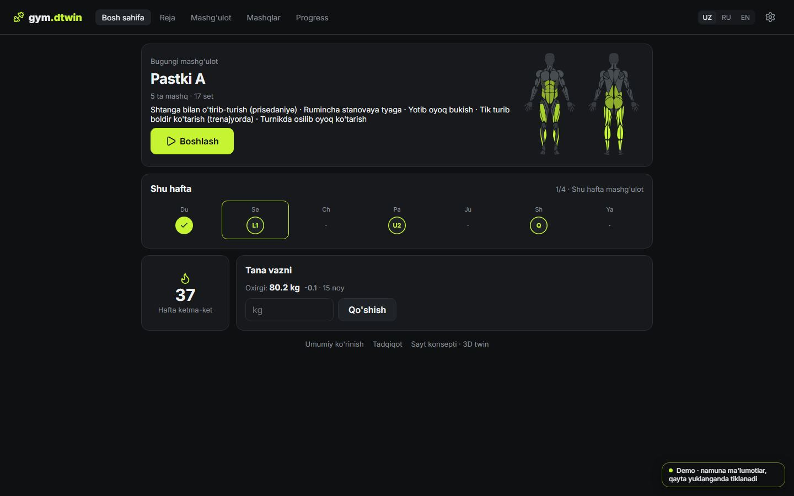

## Nima qiladi

- **Mashqlar** — 1827 mashqli kutubxona (876 tasi rasmli), uz/ru nomlar, xatoga chidamli qidiruv, filtrlar, tana xaritasi, sevimlilar va o'z mashqlaringiz.
- **Reja** — hafta yoki rotatsiya jadvali, 8 ta tayyor reja, routine editor (superset, drop set, rest-pause, progression), chop etish, Ramazon va issiq kun rejimi.
- **Mashg'ulot** — reps / vaqt / kardio setlari, warm-up, RIR/RPE, dam olish taymeri, disk kalkulyatori, almashtirish, yakuniy hisobot.
- **Progress** — statistika, 12 oylik faollik xaritasi, mushak yuklamasi, e1RM grafigi, tarixni tahrirlash, tana vazni, o'lchamlar va progress foto.
- **Ma'lumot sizda** — hammasi brauzerda (local-first); JSON backup, CSV eksport, Strong / Hevy / FitNotes import.

## Skrinshotlar

Hammasi [jonli demo](https://wonmor.io/demo/gym/)dan: fiktiv sportchining 36 haftalik kundaligi, 140+ mashg'ulot.

| | |
|---|---|
| 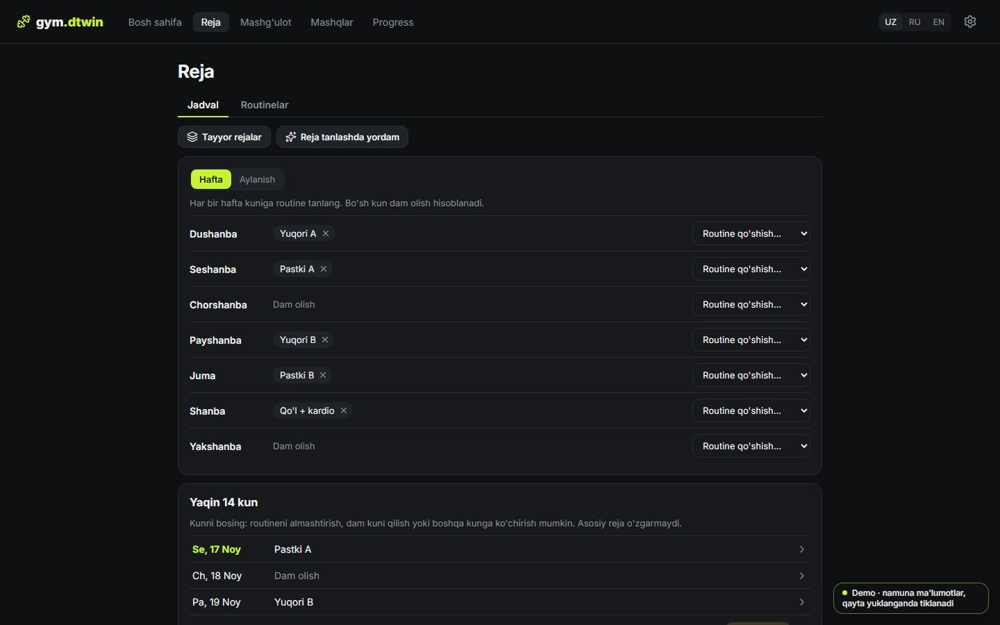 | 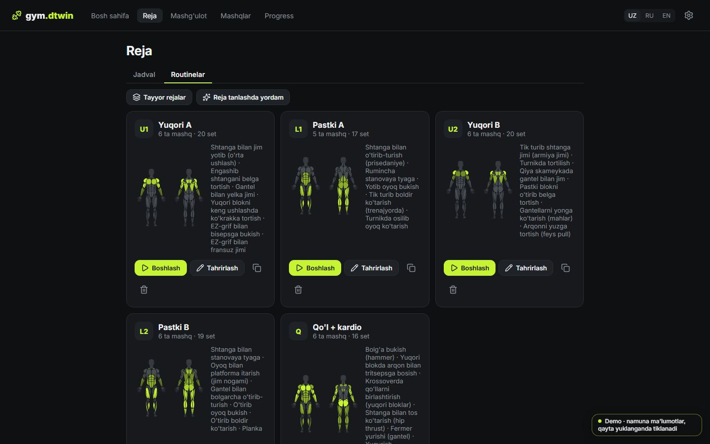 |
| Haftalik jadval: qaysi kun qaysi routine, dam olish va ko'chirilgan kunlar. | Upper/Lower dasturi va qo'shimcha "Qo'l + kardio" kuni. |
| 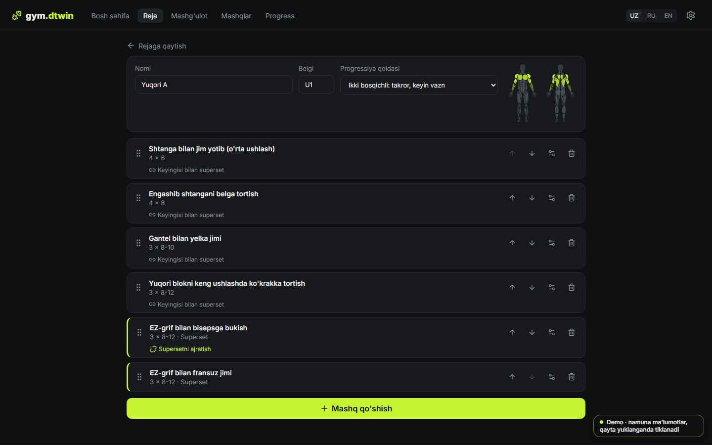 | 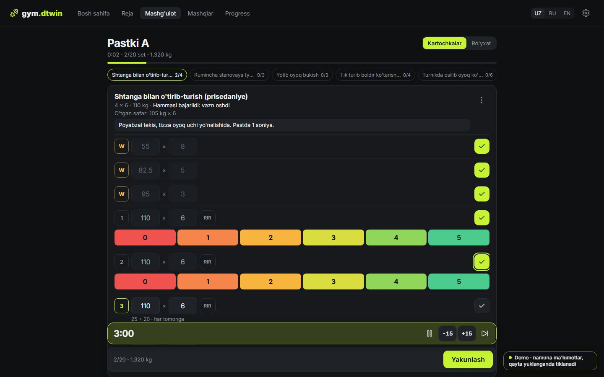 |
| Routine editor: setlar, takrorlar, progression va dam olish vaqti. | Mashg'ulot: warm-up, RIR, taymer va disk hisobi. |
| 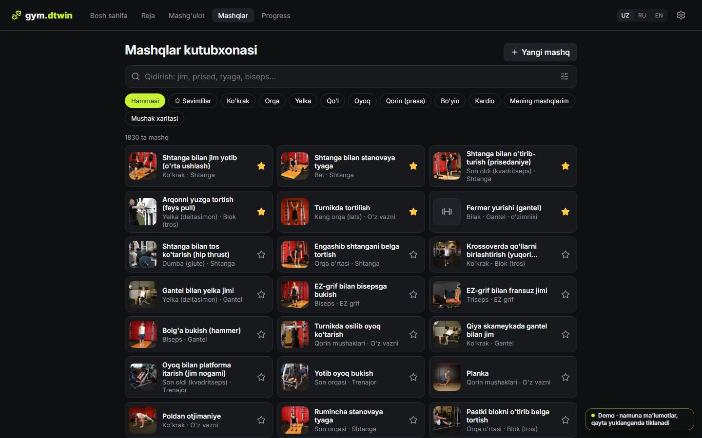 | 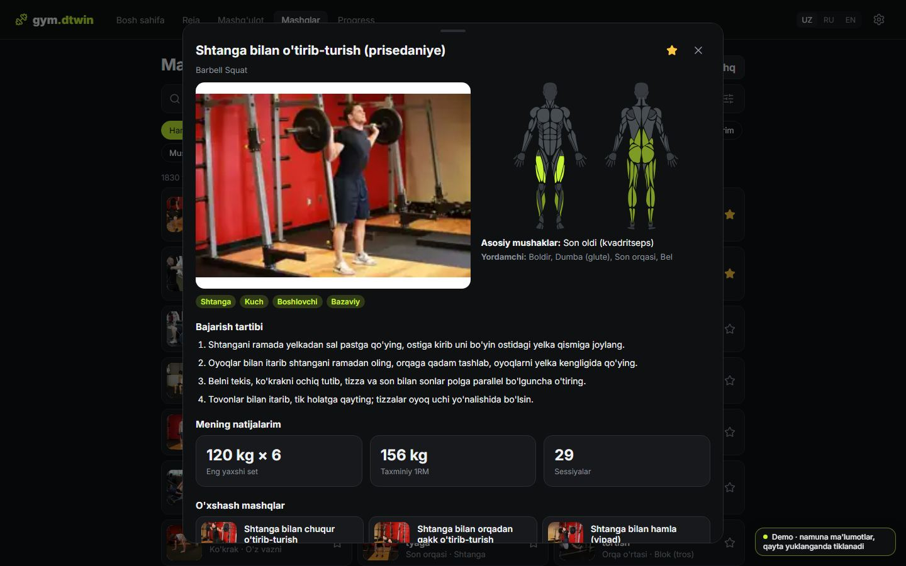 |
| 1827 mashq: qidiruv, filtr, sevimlilar. | Mashq kartasi: rasm, mushaklar, bajarish tartibi va shaxsiy natija. |
| 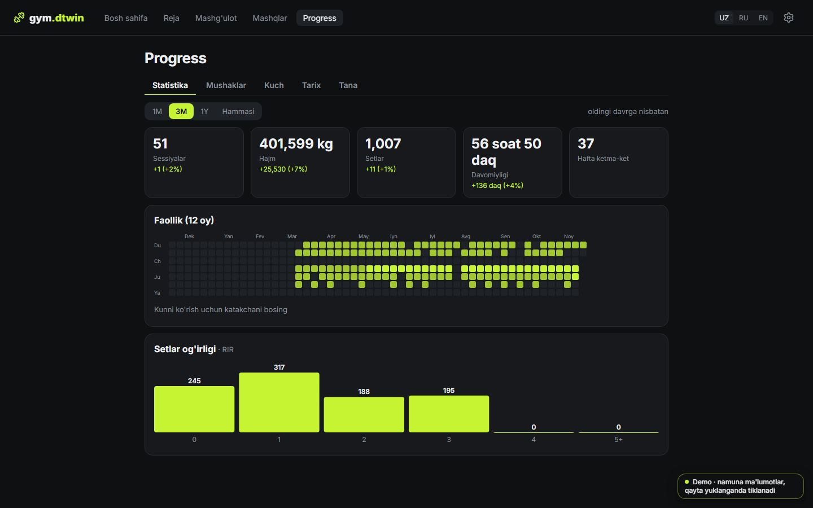 | 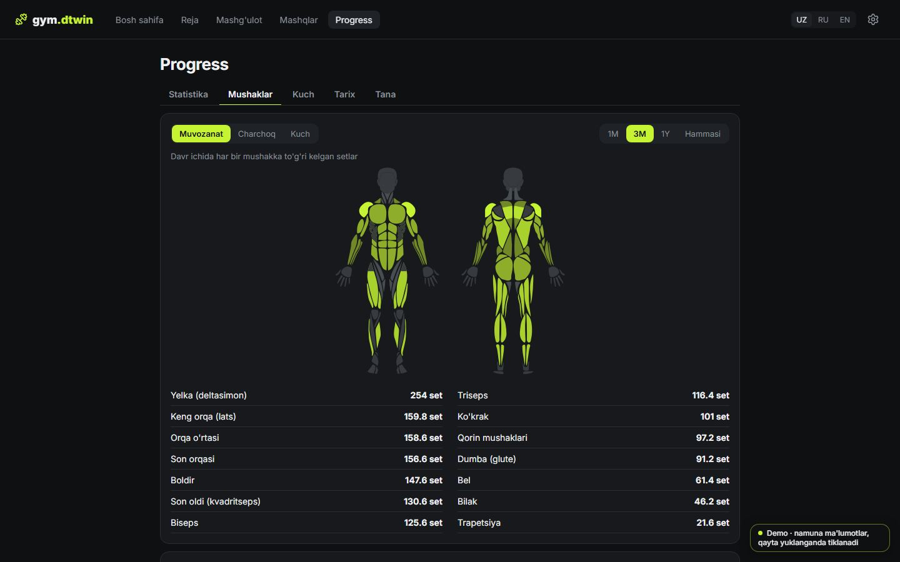 |
| Statistika: sessiyalar, hajm, faollik xaritasi, setlar og'irligi. | Mushak yuklamasi haftalik setlar bo'yicha. |
| 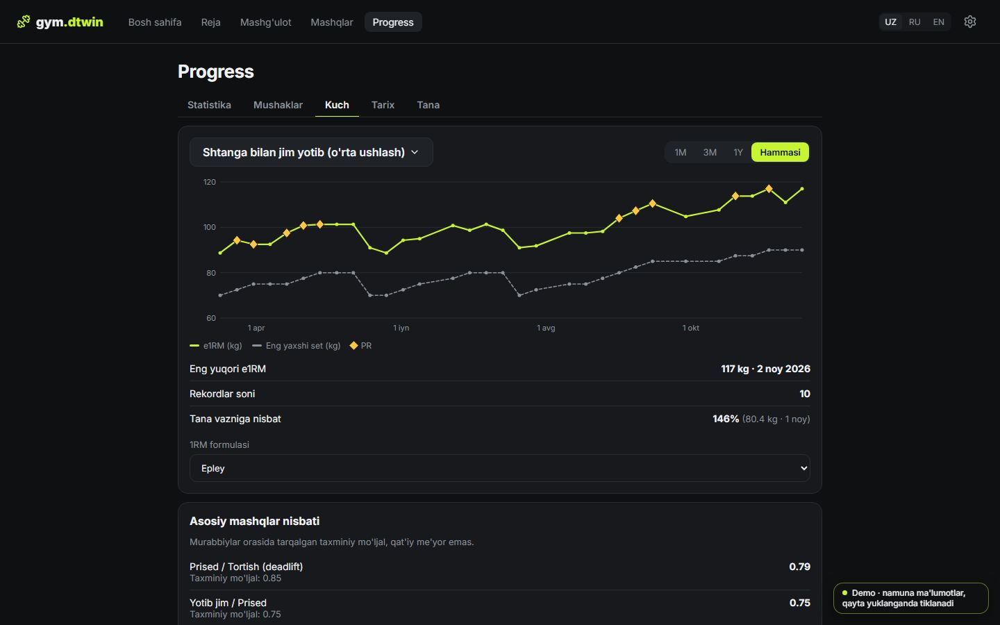 | 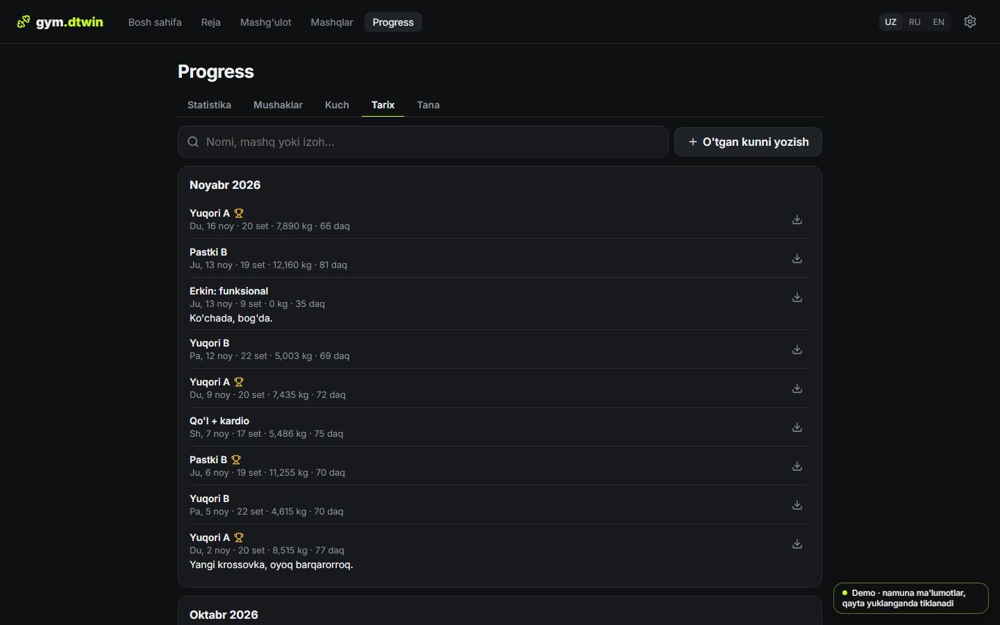 |
| Kuch: har mashq uchun e1RM grafigi va rekordlar. | Tarix: oylar bo'yicha mashg'ulotlar, rekord belgisi, izohlar. |
| 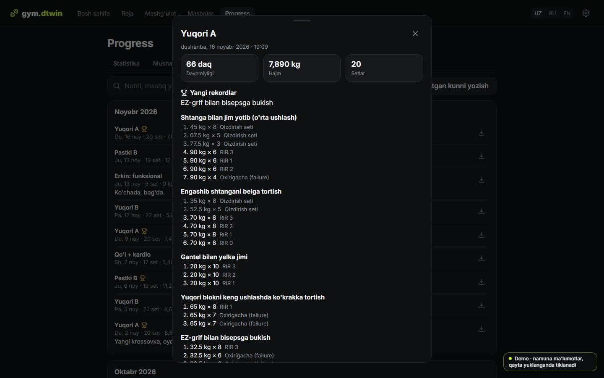 | 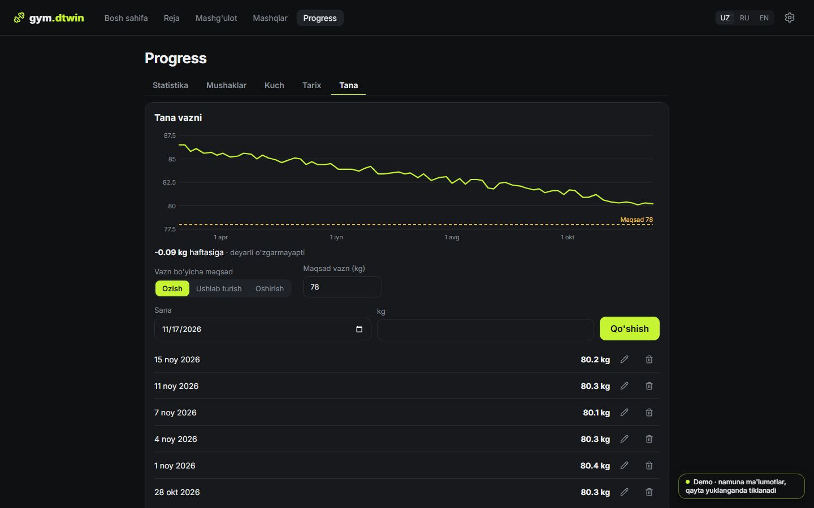 |
| Bitta mashg'ulot: setlar, hajm, davomiyligi. | Tana vazni trendi va maqsad chizig'i. |
| 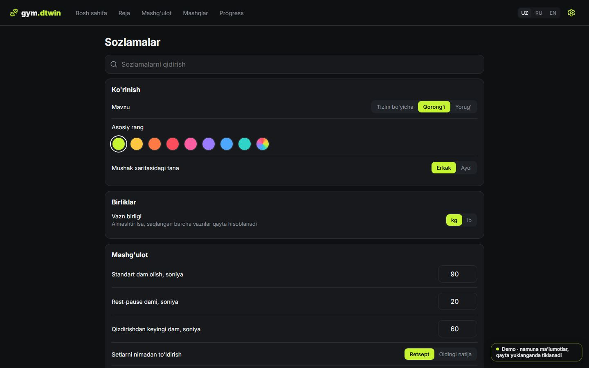 | 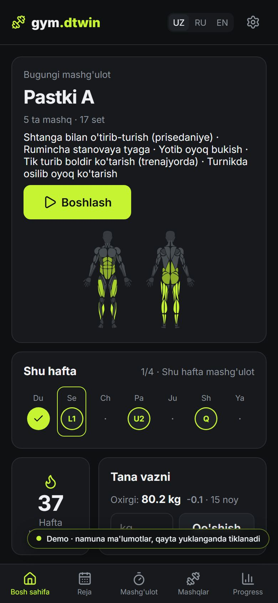 |
| Sozlamalar: til, tema, birliklar, disklar, backup. | Telefonda: pastki navigatsiya, bir qo'lda ishlatish. |

## Tez boshlash

```bash
npm install && npm run dev
```

Yoki hech narsa o'rnatmasdan: [gym.dtwin.uz](https://gym.dtwin.uz) yoki [jonli demo](https://wonmor.io/demo/gym/).

## Jonli demo

Demo — o'sha ilova, alohida rejimda yig'ilgan (`vite build --mode demo`, base `/demo/gym/`). Ma'lumot `src/demo/seed.ts` da: fiktiv sportchining 36 haftasi haqiqiy session engine orqali "o'ynaladi", shuning uchun progression, rekordlar va statistika odamdagidek chiqadi. Sanalar `Date.now()` ga nisbatan, o'zgarishlar faqat xotirada, qayta yuklanganda tiklanadi. Demo kodi faqat `--mode demo` da dinamik import qilinadi, oddiy build o'zgarmaydi.

```bash
npm run build:demo        # dist-demo/
npm run test:demo         # Playwright: har sahifa ochiladi, konsolda xato yo'q
npm run site:screenshots  # docs/screenshots/*.jpg ni qayta yaratadi
```

## Hujjatlar

- [docs/PLAN.md](docs/PLAN.md) — reja va holat, [project](https://github.com/orgs/dtwinuz/projects/10)
- [docs/W8-SYNC.md](docs/W8-SYNC.md) — sinxron va dtwin SSO (`server/` tayyor, `VITE_SYNC_ENABLED` hozircha o'chiq)
- [NOTICE](NOTICE) — katalog manbalari va litsenziyalar (free-exercise-db — Unlicense, MuscleMap — MIT, exercises-dataset — MIT). Struktura g'oyasi [openGym](https://github.com/DuarteSantos8/openGym) dan, kod va media ko'chirilmagan.

Sahifalar: `/` landing (3D shtanga), ilova `#/home`, `#/plan`, `#/workout`, `#/exercises`, `#/progress`; `/overview/` (+ `ru/`, `en/`), `/deck/tadqiqot.html`, `/deck/konsept.html`.

## Ishlab chiqish

```bash
npm run dev       # Vite dev server
npm test          # vitest
npm run lint      # oxlint
npm run build     # tsc -b && vite build -> dist/
```

Katalog generatsiya qilinadi (`src/catalogue/data/`), qo'lda tahrir qilinmaydi: `scripts/build-catalogue.mjs`, `build-images.py`, `build-musclemap.mjs`, `build-exdb.mjs`. uz/ru matnlar — `content/*.json`.

Stek: Vite, React 19, TypeScript, lucide-react, three.js (faqat landing, lazy), hash router. CI: lint, test, build (`.github/workflows/ci.yml`). Deploy qo'lda: `bash deploy/deploy.sh`.

Hissa qo'shish: [CONTRIBUTING](https://github.com/dtwinuz/.github/blob/main/CONTRIBUTING.md) · [SECURITY](https://github.com/dtwinuz/.github/blob/main/SECURITY.md) · [CODE_OF_CONDUCT](https://github.com/dtwinuz/.github/blob/main/CODE_OF_CONDUCT.md).
