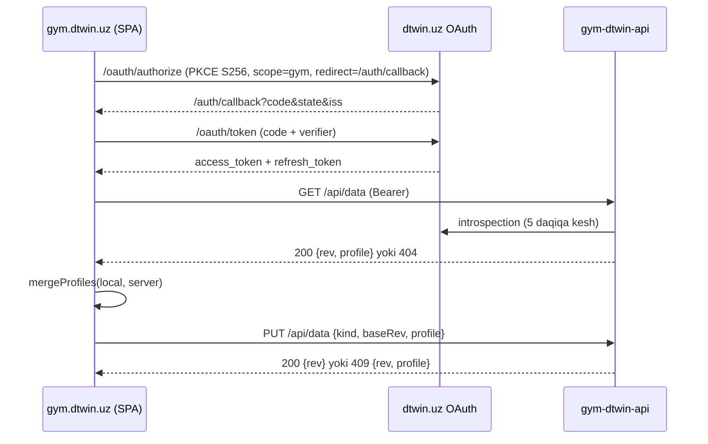

# W8: sinxron va akkaunt

Holat: kod tayyor, **deploy qilinmagan**. `VITE_SYNC_ENABLED` o'chiq bo'lsa sayt avvalgidek ishlaydi: `/api` ga ham, dtwin'ga ham so'rov ketmaydi, profilga `stamps` yozilmaydi, sync kodi bundle'ga kirmaydi. Mehmon rejimi flag yoqilganda ham asosiy rejim bo'lib qoladi.

## Arxitektura



| Qism | Fayl | Vazifa |
|---|---|---|
| Merge | `src/app/sync.ts` | sof `mergeProfiles`, `stampChanges` |
| Sikl | `src/app/syncEngine.ts` | GET, merge, PUT, 409 retry, debounce, dirty flag |
| Auth | `src/app/auth.ts` | OAuth 2.1 code + PKCE, refresh rotation |
| Ulanish | `src/app/syncBoot.ts` | faqat flag yoqilganda yuklanadi |
| UI | `src/pages/settings/Account.tsx`, `Reminders.tsx`, `src/app/SyncBanner.tsx` | Settings bo'limlari, offline banner |
| Server | `server/src/` | `node:http` + `node:sqlite`, frameworksiz |
| Eslatma | `server/src/reminders.js` | `dueReminders`, `Notifier`, `diaryEntry`; `main.js` hali yurgizmaydi |

## API

| So'rov | Javob |
|---|---|
| `GET /api/health` | `200 {ok:true}`, tokensiz |
| `GET /api/data` | `200 {kind, rev, updatedAt, owner, profile}`, hujjat yo'q bo'lsa `404 {error, owner}` |
| `PUT /api/data` `{kind:"gym-dtwin-profile", baseRev, profile}` | `200 {rev, updatedAt, owner}`, eskirgan `baseRev`: `409 {rev, profile}`, hujjat o'chirilgan: `409 {rev:0, profile:null}` |
| `DELETE /api/data` | `204`, qatorni butunlay o'chiradi |
| `DELETE /internal/users/{sub}` | `204`, idempotent. dtwin akkaunt o'chirilganda servis tokeni bilan chaqiradi. Faqat docker tarmog'i ichida: edge faqat `/api/*` ni uzatadi, `X-Forwarded-For` li so'rov `404` oladi, servis tokeni sozlanmagan bo'lsa ham `404`. Token keshidagi shu foydalanuvchi javoblari ham o'chiriladi. |

Boshqa kodlar: `400` shakl, `401` token, `413` 5 MB dan katta, `415` JSON emas, `429` limit (`Retry-After`), `503` dtwin javob bermadi (klient chiqib ketmaydi). `owner` foydalanuvchi id'sining qisqa hash'i: bitta qurilma boshqa akkauntga kirganda ma'lumot aralashib ketmasligi uchun klient shuni solishtiradi.

Yangi qatorning birinchi `rev` qiymati soat (ms), keyin `+1`. Shuning uchun o'chirishdan oldingi `rev` yangi hujjatga tasodifan mos kelmaydi va o'chirilgan foydalanuvchi uchun hech narsa saqlanmaydi.

## Merge qoidasi

| Maydon | Qoida |
|---|---|
| `routines`, `workouts`, `customEx` | `id` bo'yicha, kech `updatedAt` yutadi |
| `bodyweight`, `measurements` | `date` bo'yicha, kech `t` yutadi |
| `deleted` (tombstone) | har `id` uchun eng kech vaqt. Tombstone `>=` yozuv: yozuv o'chadi. Yozuv yangiroq: qaytadi va tombstone olinadi |
| `settings.*`, `notify.*`, `dayPlan.*`, `dayNotes.*`, `week.*`, `exWeights.*`, `exNotes.*`, `barWeights.*`, `plates.*`, `favEx.*`, skalyarlar | yo'l bo'yicha `stamps[path]`, kechi yutadi |
| `active` | vaqti `max(stamp, lastAt, start)`, yangisi yutadi; undan keyin yakunlangan yoki o'chirilgan sessiya qaytmaydi |
| `settings.unit` farq qilsa | yutqazgan tomon merge'dan oldin yutgan birlikka o'tkaziladi, yozuv vaqtlari o'zgarmaydi |

`stamps` nega kerak: `settings` va lug'atlarda vaqt yo'q, faqat umumiy `profile.updatedAt` bor. U bilan "A mavzuni, B dam olish vaqtini o'zgartirdi" holatida biri yo'qolardi, o'chirilgan kalitni esa umuman bilib bo'lmasdi. Uch tomonlama merge lokal bazaning ikkinchi nusxasini talab qilardi, bu `localStorage` hajmiga qimmat. `stamps` ixtiyoriy maydon, faqat flag yoqilganda `stampChanges` yozadi.

Migratsiya kerak emas. Stamp'siz maydon sync'dan oldin o'zgargan, shuning uchun har qanday stamp undan ustun. Ikki stamp'siz maydonda qiymat default'dan ustun, keyin `updatedAt` kattasi. Natijada yangi qurilma hech qachon haqiqiy ma'lumotni bosib ketmaydi.

`stampChanges` barcha yozuvchilarni ushlaydi (undo, restore, import): tombstone'siz yo'qolgan yozuvga tombstone beradi, qaytarilgan yozuvga yangi vaqt beradi.

Bilib qabul qilingan cheklovlar:

- Ikki qurilmada bir vaqtda turli sessiya ochilgan bo'lsa eskisi tushib qoladi.
- PR belgilari merge'dan keyin qayta hisoblanmaydi, keyingi tahrirda tuziladi.
- Soati noto'g'ri qurilma o'z o'zgarishlarini ustun qiladi (last-writer-wins tabiati).
- Tombstone'lar tozalanmaydi: uzoq vaqt offline qurilma o'chirilganni qaytarmasligi hajmdan muhimroq.

## Tokenlar: xavfsizlik qarori

| Nima | Qayerda | Nega |
|---|---|---|
| Access token | faqat xotira | XSS bo'lsa ham reload'dan keyin yo'q, 60 daqiqa |
| Refresh token | `localStorage` (`gym-dtwin:rt`) | zalda har kuni qayta kirish foydalanuvchini sync'dan voz kechtiradi |
| PKCE verifier, state | `sessionStorage`, bir martalik | redirect'dan omon qolishi kerak |

`localStorage` XSS'ga ochiq, sahifada esa tashqi widget skripti bor. Xavf shu shartlar bilan qabul qilingan:

1. dtwin refresh token'ni har safar aylantiradi va qayta ishlatishni aniqlaydi (kodda bor). Agar server yangi refresh token bermasa, klient uni `localStorage` dan olib tashlaydi va faqat xotirada ushlaydi.
2. Refresh tablar orasida Web Lock ichida, token lock ichida qayta o'qiladi. Aks holda ikki tab bir tokenni ishlatib dtwin grant'ni bekor qiladi.
3. Token faqat `gym` scope bilan chiqishi va faqat gym uchun ishlashi **shart** (quyida 2- va 3-band). Bu tasdiqlanmaguncha flag yoqilmaydi.
4. `state` va `iss` (RFC 9207) tekshiriladi, `code` URL'dan darhol olib tashlanadi.

Progress fotolar serverga bormaydi: ular alohida IndexedDB'da, sync kodi u yerga tegmaydi, server `photos` maydonini rad etadi. Server ma'lumotini o'chirishdan oldin Settings zaxira nusxa tugmasini ko'rsatadi. O'chirgandan keyin sync to'xtaydi; boshqa qurilma ham ma'lumotni qaytarib yuklamaydi, foydalanuvchi so'rasagina yuklaydi.

## Muhit o'zgaruvchilari

| Build (klient) | |
|---|---|
| `VITE_SYNC_ENABLED` | aynan `true` bo'lsagina yoqiladi |
| `VITE_DTWIN_ISSUER` | dtwin OAuth manzili |
| `VITE_DTWIN_CLIENT_ID` | standart `gym-dtwin` |

| Server | |
|---|---|
| `PORT` | standart `8080` |
| `DB_PATH` | standart `/data/gym.sqlite` |
| `TRUST_PROXY` | `1`: IP'ni `X-Forwarded-For` oxirgi qiymatidan olish |
| `DTWIN_VERIFY_MODE` | `introspect` (standart) yoki `userinfo` |
| `DTWIN_INTROSPECT_URL`, `DTWIN_SERVICE_TOKEN` | introspection uchun, sir |
| `DTWIN_USERINFO_URL` | `userinfo` rejimi uchun |
| `DTWIN_REQUIRED_SCOPE`, `DTWIN_CLIENT_ID` | standart `gym`, `gym-dtwin` |

## dtwin'dan kerak bo'lgan qadamlar

Bu ro'yxat gym tomonidan qo'yiladigan talablar. Tayyori: S256 PKCE, refresh rotation + reuse detection, `/oauth/token` va `/oauth/revoke` uchun CORS, redirect'da `iss`. Quyidagilar dtwin bilan kelishiladi:

1. **Statik OAuth client.** `client_id=gym-dtwin`, public, redirect `https://gym.dtwin.uz/auth/callback`. Client id barqaror bo'lishi kerak, redirect esa fragmentsiz haqiqiy yo'l.
2. **`gym` scope.** Token aynan so'ralgan `gym` scope bilan chiqsin, kengroq huquq bermasin. Bu tasdiqlanmaguncha flag yoqilmaydi.
3. **`gym` token faqat gym uchun.** U dtwin'ning boshqa resurslarini ochmasin. Bu ham flag yoqilishidan oldingi shart.
4. **Consent sahifasi.** `gym-dtwin` uchun AI roziligi berilmasin, matni ham AI haqida bo'lmasin (yoki birinchi tomon client sifatida consent'siz o'tsin). `gym.dtwin.uz` ishonchli host sifatida ko'rsatilsin.
5. **Introspection endpoint.** `POST /oauth/introspect` (RFC 7662), servis tokeni bilan, javobi `{active, sub, scope, client_id, exp}`. `sub` barqaror user id bo'lsin.
6. **Servis tokeni.** `DTWIN_SERVICE_TOKEN` VPS'dagi `.env` da, repoga kirmaydi.
7. **Edge Caddy.** `gym.dtwin.uz` da `/api/*` ni `gym-dtwin-api:8080` ga, qolgani `gym-dtwin:80` da. `/auth/callback` statik konteynerda: `deploy/Caddyfile` allaqachon `index.html` ga qaytaradi. CSP bo'lsa `connect-src` ga `dtwin.uz` qo'shilsin.
8. **Konteyner.** `deploy/api/docker-compose.example.yml` asosida `/opt/gym-dtwin/api`, tarmoq `dtwin-prod_default`, volume `./data` (uid 1000 ga yozish huquqi), `TRUST_PROXY=1`.
9. **Backup.** Gym tomoni tayyor: `deploy/api/backup.sh` (`VACUUM INTO`, nusxa ochilib `integrity_check` va har hujjat JSON tekshiriladi, oxirgi 14 tasi qoladi). dtwin tomonidan kerak: shu skriptni kunlik backup jadvaliga qo'shish va `./backups` ni offsite nusxaga olish.
10. **Notifier (#60).** `POST /internal/notify {userId, text}`, servis tokeni, bot bog'lanmagan foydalanuvchi uchun aniq javob kodi. Foydalanuvchi Telegram'ga bog'langanmi degan ma'lumot ham shu tomonda.
11. **Kundalik (#61).** `POST /internal/diary {userId, id, date, name, minutes, volume}` va o'chirish uchun `DELETE /internal/diary/{id}`, `id` bo'yicha idempotent.
12. **Akkaunt o'chirilishi.** dtwin foydalanuvchini o'chirganda gym'ga xabar (`DELETE` hodisasi), aks holda SQLite'da qator qoladi.

#60 uchun bu tomonda qolgani: `main.js` da 15 daqiqalik cron, `Notifier` ning HTTP implementatsiyasi, yuborilganlar jadvali, haftalik hisobot. #61: `diaryEntry` ni yakunlangan sessiyaga ulash.

## Rollout

1. Yuqoridagi 1-6 dtwin tomonda, dev muhitda sinov.
2. API konteyner, Caddy `/api/*`, `curl /api/health`. Klient hali o'zgarmagan.
3. Dev bilan E2E: kirish, ikki qurilma, `409`, offline, o'chirish, chiqish.
4. `VITE_SYNC_ENABLED=true` va `VITE_DTWIN_ISSUER` bilan build, deploy. Avval faqat egasining akkaunti bilan.
5. 1 hafta log va SQLite hajmi kuzatiladi, keyin ochiq e'lon.

Build o'zgaruvchilari `deploy/deploy.sh` da yo'q: yoqish uchun deploy qiluvchi shell'da eksport qiladi. Bu ataylab, keyingi oddiy deploy flag'ni tasodifan yoqmaydi.

## Server: o'rnatish, backup, tiklash

- O'rnatish: `bash deploy/api/install.sh dtwin` kodni `/opt/gym-dtwin/api` ga ko'chiradi va image yig'adi. Konteyner faqat `--start` bilan ishga tushadi. `.env` faqat serverda (600), repoda yo'q.
- Backup: serverda `/opt/gym-dtwin/api/backup.sh`. WAL rejimidagi bazani `cp` bilan nusxalash yaroqsiz, shuning uchun `VACUUM INTO`.
- Tiklash: `docker compose stop gym-dtwin-api`, `data/gym.sqlite*` ni chetga olish, backup faylini `data/gym.sqlite` qilib nusxalash (egasi uid 1000), `docker compose up -d`. Qurilmalardagi yangi yozuvlar `409` va merge orqali qaytadi.
- Tiklash sinovi: `server/test/backup.test.js` (WAL'dagi yozuvlar nusxada bor, tiklangan bazaga yozish ishlaydi, buzuq fayl rad etiladi) va serverdagi image bilan vaqtinchalik papkada 500 profil: backup, tiklash, o'qish, yozish o'tdi.

## Orqaga qaytarish

| Muammo | Harakat | Oqibat |
|---|---|---|
| Klient xatosi | flag'siz qayta build va deploy | ma'lumot brauzerda qoladi, `stamps` zararsiz ortiqcha maydon |
| API xatosi | `docker compose stop gym-dtwin-api` | klient offline holatiga o'tadi, `dirty` saqlanadi, qaytganda yuboradi |
| Buzilgan server ma'lumoti | SQLite'ni backup'dan tiklash | hujjat eskiroq bo'ladi, qurilmalar merge bilan yangi yozuvlarni qaytaradi |
| dtwin token xavfi | client'ni o'chirish yoki `gym` tokenlarini revoke | klient `auth` holatiga o'tadi, mehmon sifatida ishlashda davom etadi |

Hech bir holatda lokal ma'lumot o'chmaydi: server javobi avval `readProfile` bilan tekshiriladi, yaroqsiz javob hech narsani o'zgartirmaydi.

## Lokal ishga tushirish

```bash
npm test                # klient va server testlari (vitest, haqiqiy vaqtinchalik SQLite)
DB_PATH=./gym.sqlite DTWIN_INTROSPECT_URL=... DTWIN_SERVICE_TOKEN=... node server/src/main.js
VITE_SYNC_ENABLED=true VITE_DTWIN_ISSUER=... npm run build
```
